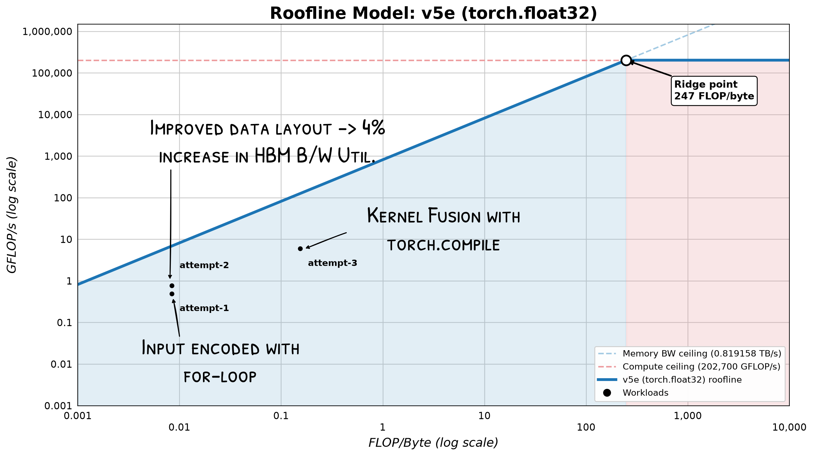

# Motivation

A while ago, recurrent neural nets (RNNs) were unseated by the transformer for complex sequence modelling tasks. The transformer went on to become the de-facto building block of foundation models, where an ugly tradeoff emerges. At inference time, transformers crucially trade off **accuracy for latency**. The KV cache used for generating tokens autoregressively grows linearly with sequence length, and memory bandwidth becomes a bottleneck and impediment to fast inference. A tradeoff exists because one could choose to drop entries from the KV cache, thereby reducing its bandwidth usage, which would likely lead to accuracy degradation.

One night, when I was debugging a memory allocation bug in vLLM specifically targeting the Qwen open-weight models, I was surprised to find out that some blocks in these models use *constant* space for their inference state. Clearly, the community was surprised too: vLLM at the time did not have a way to allocate physical memory for these special blocks independently of traditional attention-based blocks - the assumption that inference state grew linearly with sequence length was still very much entrenched within the system. 

Can we build an accurate model entirely out of these memory-efficient building blocks, side-stepping the accuracy vs. latency tradeoff that comes with transformers? For now, that seems unlikely, but these blocks, known in the literature as **Mamba blocks**, are here to stay. However, the rich toolkit developed for transformer inference optimization - KV cache compression, paged attention, flash attention, and more - will not be readily applicable. So how can we perform efficient inference with these transformer alternatives?

## What Makes an SSM Different from a Transformer?

To understand how these models are implemented in code, a basic understanding of their math is helpful. The "state" in a structured state space sequence model (SSM) has a fixed size regardless of input length, while a transformer's attention mechanism computes a dot product for each previous key. At each step $i$ of generation, a transformer computes $i - 1$ dot products in its masked-self attention layer. Repeatedly performing this step to grow a sequence up to $n$ tokens results in inference that is quadratic in $n$. 

## TPU v5e Roofline Model

Before porting the custom CUDA kernels for selective scan to TPU, let's see how SSMs perform using hidden state updates computed sequentially over an input with $L$ positions:

## References

\[1] A. Gu and T. Dao, “Mamba: Linear-Time Sequence Modeling With Selective State Spaces,” arXiv.org, Dec. 01, 2023. https://arxiv.org/abs/2312.00752 (accessed Oct. 22, 2026).
