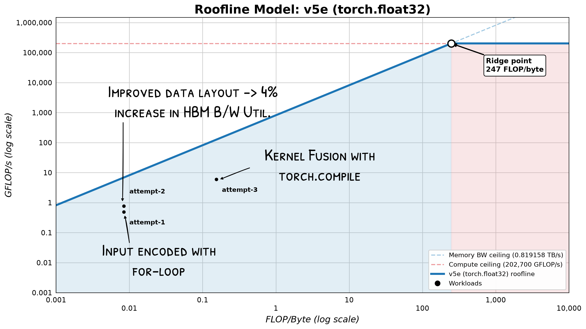

# What Makes an SSM Different from a Transformer?
 
The "state" in a structured state space sequence model (SSM) has a fixed size regardless of input length, while a transformer's attention mechanism computes a dot product for each previous key. At each step $i$ of generation a transformer computes $i - 1$ dot products in its masked-self attention layer. Repeatedly performing this step to grow a sequence up to $n$ tokens results in inference that is quadratic in n. 

# TPU v5e Roofline Model for Baseline Implementation

Without porting the custom CUDA kernels for selective scan to TPU just yet, let's see how SSMs perform without a more naive selection mechanism. I'm using a TPU v5e, which features TensorCores with massive matrix multiply units like newer TPU generations, at a lower cost.

# References

[1] A. Gu and T. Dao, “Mamba: Linear-Time Sequence Modeling With Selective State Spaces,” arXiv.org, Dec. 01, 2023. https://arxiv.org/abs/2312.00752 (accessed Oct. 22, 2026).

